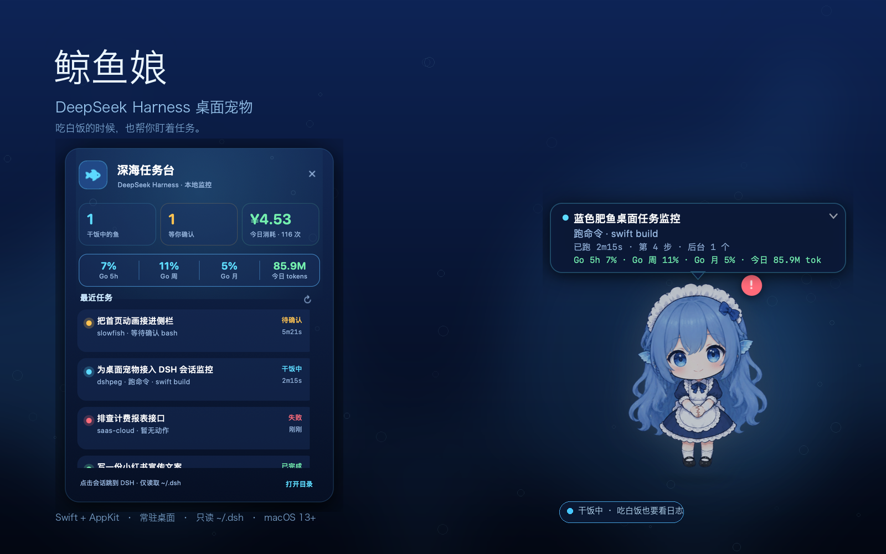

# 鲸鱼娘 · DeepSeek Harness 桌面宠物

[下载安装包](https://github.com/davyxiaoxiao/whalegirl/releases) · [DSH 插件](https://github.com/davyxiaoxiao/dsh-plugin-bluefish-pet)



一只独立运行的 macOS 桌面宠物：**Q 版**蓝发女仆、小号鱼鳍耳、两条细腿（没有鱼尾）；干饭时趴在桌上吃白米饭，被你拖来拖去的时候会迈开小短腿走路。它顺便帮你盯着 DSH 的任务。

它**不是 DSH 插件**，也不依赖 DSH 的窗口。DSH 最小化、切到别的 App、甚至只开着一个终端里的 `dsh`，小鱼都还在桌面上。

---

## 它现在会做什么

- **常驻桌面**：无边框、透明、置顶，所有 Space 可见；透明区域鼠标穿透，不会挡住正常点击。
- **任务看板**：点一下宠物打开「深海任务台」，看每个会话在做什么、跑了多久、什么时候完成、今天花了多少钱。
- **跳到 DSH 会话**：点任务行会激活 DSH 桌面版，并在它的侧栏里找到对应会话点开（通过 macOS 辅助功能 API）。首次使用需要在「系统设置 → 隐私与安全性 → 辅助功能」里勾选鲸鱼娘；没授权时会退化成「把会话名复制到剪贴板 + 把 DSH 切到前台」。
- **状态立绘**：待命 / 干饭（吃白饭）/ 等你确认 / 出错 / 完成 / 睡觉 / **DSH 断连**，共 7 种状态。
- **断连提示**：DSH 退出或后端没了时，鲸鱼娘会变暗、挂一个红色「!」徽章，头顶状态条和菜单栏都显示「DSH 断连」，并弹一次「DSH 断连了」；DSH 重新起来后会自动恢复并弹「重新连上啦」。
- **随 DSH 自动启动**：插件默认在 DSH 启动后自动拉起鲸鱼娘（没运行就启动，隐藏了就显示），不用再单独打开；想关掉可在插件条目配置 `autoStart: false`。
- **干饭中气泡**：DSH 干饭时，宠物头顶常驻一个气泡，显示任务名、当前动作（跑命令 / 改代码 / 读文件…）、已跑时长、第几步、后台任务数，以及费用额度（Go 5h / 周 / 月百分比 + 今日 tokens），每秒刷新。
- **费用 / 额度**：直接读 `dsh-cost-meter` 的 `ledger.json` —— 套餐窗口百分比取自 `planSamples`，今日 tokens 与插件侧栏口径一致（`input + output + cacheRead + cacheWrite + reasoning`），另外保留今日花费（CNY）。
- **拖动走路（带方向）**：按住拖动时切换成三帧走路循环（左脚在前 / 过渡 / 右脚在前）；宠物会朝着你**当前移动的方向**走——往右拖面朝右、往左拖自动镜像面朝左（按每次鼠标移动的平滑速度判断，拖到最左边再往右拖会立刻转身，不是看相对起点的偏移），身体微微朝移动方向倾斜，并且窗口会以 60Hz 平滑追随指针（不是每个鼠标事件跳一次），看起来是「走过去」而不是被瞬移；松手滑到落点后恢复当前任务状态。
  - 丝滑 / 无残影的几个细节：立绘相关图层全部关闭隐式动画（否则换图会自带 0.25s 交叉淡入，就是残影的来源）；换帧只换 `contents`、不重新布局；三帧 0.2s 一帧、浮动 0.3s 与脚步同步；倾斜用独立的 `leanLayer`，不会打断摇摆动画。
- **事件提醒**：
  - 有任务需要你确认：琥珀色气泡常驻 + 提示音；
  - 任务完成：开心跳一下 + 气泡 + 音效；
  - 任务失败：惊慌表情 + 抖动 + 气泡。
- **菜单栏小鱼**：带状态色点；菜单里有暂停监控、提示音开关、回到右下角、隐藏桌宠、退出。
- **只读本地**：只读取 `~/.dsh/sessions` 和 `~/.dsh/storages/cost-meter`，不联网，不改 DSH 配置。

## 运行

要求 macOS 13+（当前为 Apple Silicon 构建）。

```bash
open build/WhaleGirl.app
# 或者
make run
```

装进 Applications：

```bash
cp -R build/WhaleGirl.app /Applications/
open /Applications/WhaleGirl.app
```

开机自启：**系统设置 → 通用 → 登录项 → +**，选择 `WhaleGirl.app`。

第一次启动它会出现在屏幕右下角（Dock 上方），直接拖动即可换位置；位置和提示音设置会自动保存。

## 操作

| 操作 | 效果 |
| --- | --- |
| 单击宠物 | 打开 / 收起任务面板 |
| 点击头顶气泡 | 收起任务信息，变成「▸ 任务」小条；再点小条展开 |
| 点击「▸ 任务」 | 展开回完整任务气泡 |
| 看头顶气泡 | 干饭中显示任务名 / 动作 / 时长 / 套餐额度 / 今日 tokens；等你确认 / 完成 / 出错时自动切换 |
| 看任务面板用量条 | `Go 5h %`、`Go 周 %`、`Go 月 %`、`今日 tokens` 四个数字 |
| 拖动宠物 | 移动位置（靠近屏幕边缘会吸附）；拖动期间播放走路帧动画 |
| 双击宠物 | 咕噜咕噜～随机互动 |
| 右键宠物 | 快捷菜单（任务面板、暂停、提示音、重置位置、退出） |
| 菜单栏小鱼 | 状态摘要、最近任务、暂停监控、提示音、重置位置、退出 |
| 点击任务行 | 跳到 DSH 桌面版里对应的会话 |
| 右键任务行 | 跳到 DSH 会话 / 在 Finder 中打开工作区 / 复制会话 ID / 复制日志路径 |
| 右键宠物 → 授权跳转 | 打开辅助功能授权提示和系统设置面板 |

## 状态是怎么推断的

DSH 的会话日志是 **多帧 zstd 压缩的 JSONL 事件流**。鲸鱼娘不装插件，只读这份日志：

| 状态 | 依据 |
| --- | --- |
| 干饭中 | 最近有 `turn/start`，其后还没有 `turn/end`，且日志在 4 分钟内仍在更新 |
| 等你确认 | 有 `approval/asked`，且找不到对应的 `approval/decided` |
| 出错 | `turn/end` 的 `reason.kind` 为 `error`（或 `aborted`） |
| 完成 | `turn/end` 的 `reason.kind` 为 `completed`，保持约 2 分钟庆祝状态 |
| 疑似卡住 | 还在 turn 里，但超过 6 分钟没有任何新事件 |
| 睡觉 | 最近一条会话事件超过 20 分钟 |
| 干饭内容 | 最近一次 `tool/call`（跑命令 / 改代码 / 读文件 / 画图 / 派子代理…） |

- **任务时长**从最近一条 `user/message`（对首轮任务则是会话里的首条用户消息）算起，不是单次模型 turn，所以长任务会显示「1h12m」而不是「40s」。
- **今日消耗**来自 `~/.dsh/storages/cost-meter/ledger.json`；如果没装 cost-meter，面板显示 `—`。
- 会话标题来自 `session/title`；工作区路径来自会话头的 `cwd`；已归档会话会按 `workspace.json` 过滤掉。

## 实现要点

- **Swift + AppKit**，一个菜单栏 App，不用 Electron / WebView。
- 透明无边框 `NSPanel` + Core Animation 做立绘、气泡、粒子、呼吸浮动；鼠标穿透由定时器 + `ignoresMouseEvents` 控制，只在指针真正落在宠物/气泡上时接收点击。
- **按需解压**：日志 5 MB 的时候整份解压要几十毫秒；这里只读文件末尾 384 KB，从 zstd 帧边界开始解，一次刷新约 1~2 ms。文件没变化就完全跳过。
- **内置 zstd helper**：`scripts/zstd_helper.c` 静态链接 `libzstd.a`，编译成 `WhaleGirl.app/Contents/MacOS/zstd-helper`。运行时不需要 Homebrew zstd。
- 首次启动会全量扫一遍现有会话（约 2~3 秒），之后每次 1.5 秒增量刷新。

## 动作管理器

所有动作集中定义在 `Sources/BlueFish/PetAction.swift` 的一张表里：

| 动作 | 帧 | 帧间隔 | 缩放 | 浮动 | 摇摆 | 徽章 | 粒子 |
| --- | --- | --- | --- | --- | --- | --- | --- |
| idle | pet_idle | — | 1.0 | 5 / 3.0s | 0.014 | — | 慢气泡 |
| work | pet_work | — | 0.85 | 3.5 / 1.45s | 0.020 | — | 快气泡 |
| wait | pet_idle | — | 1.0 | 2.5 / 2.2s | 0.014 | ! | — |
| happy | pet_happy | — | 1.0 | 6 / 1.1s | 0.014 | — | 星星 |
| panic | pet_panic | — | 1.0 | 4 / 0.55s | 0.030 | ! | — |
| sleep | pet_idle | — | 1.0 | 7 / 4.4s | 0.012 | — | 慢气泡 + zzz |
| offline | pet_idle | — | 1.0 | 3 / 3.6s | 0.014 | — | — |
| walk | pet_walk_a / b / c（朝右，往左镜像） | 0.2s | 1.0 | 2.2 / 0.3s | 0.02 | — | 慢气泡 |

- `PetActionManager` 决定当前动作、按 `frameInterval` 切帧，并处理「拖动时走路优先、松手恢复当前心情」。
- `PetSpriteView` 只负责渲染：`applyAction` 配置一次（帧、缩放、浮动、摇摆、徽章、粒子），`applyFrame` 只换图；三帧走路共用同一张对齐画布，所以换帧不位移、不闪。
- 想加新动作：在 `PetAction` 里加一条记录，把对应 PNG 放进 `Assets/`，然后在需要的地方调用 `actionManager.play(...)`（目前入口是 `setMood` / `startWalking`）。

## 构建

```bash
make build       # 编译并打包 build/WhaleGirl.app
make run         # 构建后启动
make snapshot    # 把 7 个状态 + 任务面板渲染到 snapshots/
make preview     # 生成 README 的 preview.png
make art         # 从 dsh-image-gen/image-b35645c3.png 重新切 Q 版四态立绘
make walk        # 从 dsh-image-gen/image-0b00dab6.png 重新切两帧走路图
make dist        # 打一个 dist/鲸鱼娘.zip
```

构建期需要：

- Xcode Command Line Tools（`swiftc`、`iconutil`、`clang`）；
- Homebrew 的 zstd 静态库：`/opt/homebrew/opt/zstd/lib/libzstd.a`（只用于编译内置 helper，不会成为运行时依赖）。

### 换立绘

四张透明 PNG 放在 `Assets/`：

```text
Assets/pet_idle.png    待命 / 睡觉 / 等待确认
Assets/pet_work.png    干饭（吃白饭）
Assets/pet_happy.png   完成
Assets/pet_panic.png   出错
Assets/pet_walk_a.png  拖动走路 · 朝右 · 右脚在前
Assets/pet_walk_b.png  拖动走路 · 朝右 · 过渡帧
Assets/pet_walk_c.png  拖动走路 · 朝右 · 左脚在前
```

- Q 版四态原图切分：`scripts/prepare_sheet.py`，当前切分线 `x=620, y=620`（`make art`）。
- 走路三帧切分：`scripts/prepare_walk.py dsh-image-gen/image-bce7de69.png --splits 486,978`（`make walk`）；三帧是朝右的三分之四侧身，往左走时整体镜像。三帧统一对齐到同一画布（头部中心 + 地平线），所以换帧不会抖。
- 工作姿态比站立姿态容易显大，`Sources/BlueFish/PetView.swift` 里 `moodScale` 当前是 `0.85`；想再小改这个值即可。
- 角色设定：Q 版、小号蓝色鱼鳍耳、两条细腿、无鱼尾；根据用户提供的 DeepSeek-chan 同人图重绘。

## 目录

```text
Sources/BlueFish/
  main.swift               入口 / --dump 诊断
  AppDelegate.swift        启动与快照模式
  DSHMonitor.swift         会话日志扫描、zstd 尾解压、状态机
  Models.swift             会话/全局状态模型
  PetWindowController.swift 桌宠窗口、气泡、菜单栏联动
  PetAction.swift          动作表 + PetActionManager（所有动作的帧/时长/动画/徽章/粒子）
  PetView.swift            立绘渲染、气泡、粒子、命中区域
  StatusCard.swift         深海任务台面板
  MenuBar.swift            菜单栏小鱼
  Theme.swift              配色、字体、格式化
  Snapshot.swift           离屏渲染预览
Assets/                    四态立绘 + 图标
scripts/build_app.sh       打包 .app
scripts/zstd_helper.c      内置 zstd 解码器
scripts/prepare_sheet.py   切四态立绘 + 图标
scripts/prepare_walk.py    切两帧走路图
scripts/make_preview.py    README 海报
```

## DSH 插件

想让 DSH 侧边栏出现「鲸鱼娘」按钮、并随 DSH 自动启动：

- 插件仓库：[dsh-plugin-bluefish-pet](https://github.com/davyxiaoxiao/dsh-plugin-bluefish-pet)
- 在 DSH 左侧「插件」页输入 `github:davyxiaoxiao/dsh-plugin-bluefish-pet` 安装，重启 DSH；
- 插件会从 `/Applications/WhaleGirl.app` 启动本 App；侧边栏按钮通过 App 内置的 `127.0.0.1:47113` 控制端口切换显示 / 隐藏。

## 调试

```bash
# 打印当前推断出来的所有会话状态
./build/WhaleGirl.app/Contents/MacOS/WhaleGirl --dump

# 启动时打开任务面板，并把窗口/点击穿透日志写到 ~/Library/Logs/whalegirl.log
./build/WhaleGirl.app/Contents/MacOS/BlueFish --log --open-card
```

## 隐私

- 全程离线，没有任何网络请求。
- 只读 `~/.dsh/sessions`、`~/.dsh/storages/workspace.json` 和 `~/.dsh/storages/cost-meter/ledger.json`。
- 不读写 DSH 的会话内容以外的数据，不上传任何东西。
- 自身只在 `~/Library/Preferences/com.daiwei.bluefish.plist` 存位置和提示音开关。

## 已知取舍

- 状态来自日志推断，不是 DSH 内部 API；日志被清理、单帧超过 2 MB、或者刚好卡在两个 turn 之间时，会退化成「待命中」而不是「干饭中」。
- 没有系统通知中心推送，只有气泡 + 音效 + 菜单栏色点；如果桌宠被隐藏，瞬间提示会错过。
- 「跳到 DSH 会话」依赖辅助功能权限和 DSH 侧栏里的会话名匹配；侧栏收起、会话名被改过或 DSH 没开时会退化成复制会话名。每次重新构建 App 后 ad-hoc 签名会变，可能需要在辅助功能里重新勾选一次。
- 本地 ad-hoc 签名；拷到另一台 Mac 首次打开可能需要右键 → 打开。
- 角色是 DeepSeek 同人二创，仅作个人桌面装饰使用。

## 后续可以加

- 系统通知 / 任务完成时 Dock 弹跳；
- 多屏幕独立宠物、自动游走；
- 任务面板里的 token / 预算趋势图；
- 一键把 DSH 会话面板叫到前台（需要 DSH 暴露稳定入口）。

---

立绘参考：用户提供的 DeepSeek-chan 同人图；zstd 由 Meta/Facebook 的 zstd 项目提供。
